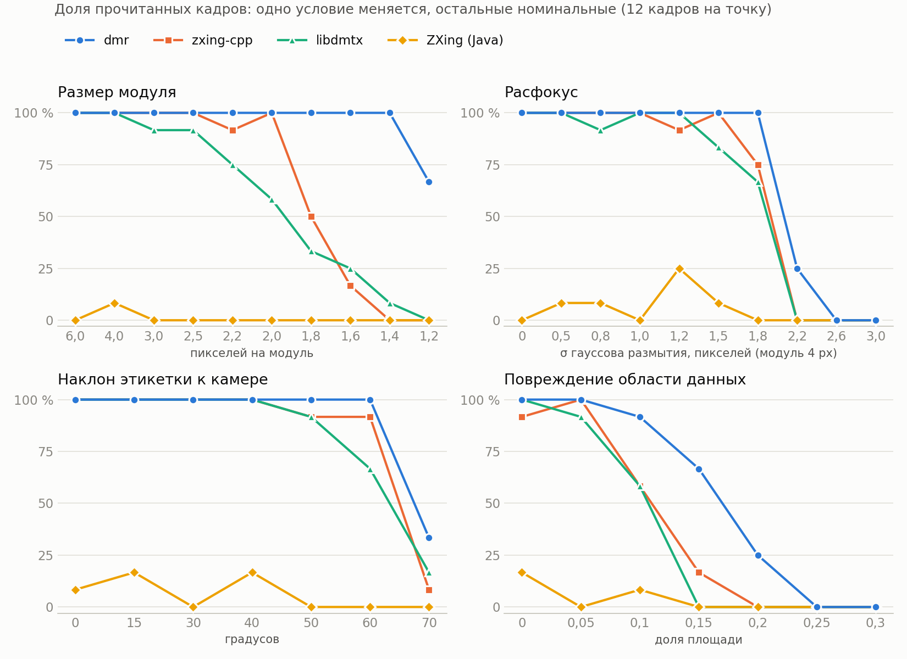

# DataMatrix readers on synthetic production-line frames

[Русская версия](README.ru.md)

An open, reproducible comparison of four DataMatrix (ECC 200) readers on 1368
synthetic frames that imitate a camera over a conveyor: small modules, any
rotation, blur, tilt, damage, curved and crumpled labels. Every frame, the
expected string of every frame, the generator and the measurement programs are
published here, so every number below can be checked and extended.

The write-up of this comparison (in Russian) — on Habr:
[«Читаем DataMatrix с конвейера: открытое сравнение четырёх библиотек на 1368 синтетических кадрах»](https://habr.com/ru/articles/1096110/).

| reader | version |
|---|---|
| dmr — [DataMatrix Reader](https://github.com/libscanner/datamatrix-reader) (ours) | 1.0.7 |
| [zxing-cpp](https://github.com/zxing-cpp/zxing-cpp) | 3.1.1 (Python binding) |
| [ZXing](https://github.com/zxing/zxing) (Java) | 3.5.4 |
| [libdmtx](https://github.com/dmtx/libdmtx) | 0.7.8 |

Commercial SDKs are not included: the licence terms of most of them prohibit
publishing benchmark results without the vendor's consent.

## Results

| reader | read of 1368 | wrong reads | median time per frame |
|---|---:|---:|---:|
| **dmr 1.0.7** | **1126 (82.3 %)** | 0 | 5.7 ms |
| zxing-cpp | 955 (69.8 %) | 0 | 1.9 ms |
| libdmtx | 892 (65.2 %) | 0 | 12.1 ms |
| ZXing (Java) | 43 (3.1 %) | 0 | 0.8 ms |

**Read** = the decoded string equals the encoded one; **wrong** = a non-empty
string that differs from it. The overall share depends on which values of each
condition were chosen; the limits below say more.

Worst value, moving away from the nominal one, at which a reader still reads
at least 90 % of the frames of a point:

| condition | dmr | zxing-cpp | libdmtx |
|---|---|---|---|
| module size, px | **1.4** | 2.0 | 2.5 |
| in-plane rotation (at 2.5 px/module) | **any** | ≤ 20° | ≤ 30° |
| defocus σ, px | **1.8** | 1.5 | 1.2 |
| motion blur, px | **6** | 4 | 5 |
| noise σ, grey levels | 30 | 30 | 10 |
| print contrast | **0.05** | 0.12 | 0.12 |
| JPEG quality | 5 | 5 | 10 |
| tilt of the label plane | 60° | 60° | 50° |
| dot gain (share of module) | **−55 … +70 %** | −30 … +30 % | −30 … +30 % |
| damage of the data area | **10 %** | 5 % | 5 % |
| same, symbol without padding | 5 % | 5 % | 5 % |
| label bent on a cylinder (arc) | **180°** | 150° | 60° |
| wave, modules | **0.5** | 0.25 | 0 (flat only) |
| crumpled paper, modules | 0.15 | 0.15 | 0 (flat only) |
| film with folds and glare, modules | 0.25 | 0.25 | 0.25 |
| inverted (light on dark) | yes | yes | yes |

dmr values for rotation, contrast 0.05, JPEG 5, dot gain and bend 180° are the
end of the tested range, not a measured limit. ZXing (Java) is left out of the
table: it reaches 90 % at no point of any condition, not even at the nominal
one — it does not find symbols below about 5 px per module.

Frames read by a competitor but not by dmr: 12 (noise σ = 60: libdmtx 6 of 12,
dmr 3; a symbol without padding with 10 % damage: zxing-cpp and libdmtx 6 of 12,
dmr 3). Frames read only by dmr: 126. Read by nobody: 230.

Full tables per point: [synthetic/results/summary_synth.md](synthetic/results/summary_synth.md),
[per_point.csv](synthetic/results/per_point.csv); raw per-frame results of every
reader: [synthetic/results/raw](synthetic/results/raw).

## The set

720×540 grey frames, one code per frame on a white label on a grey background
with uneven light. Nominal conditions: 4 px per module, random rotation
0–360°, print contrast 0.85, noise σ = 3. One condition is changed at a time
(16 conditions, see the table). 12 frames per point: symbols 16×16, 22×22 and
40×40 in turn, each with its own random digits filling 60–85 % of the symbol
capacity like real codes (the "without padding" condition: 100 %).

The symbols come from our own generator (dmgen), so the first check is that
they are standard: on the 96 undistorted nominal frames dmr and libdmtx read
96, zxing-cpp 95, ZXing 8 (the module is too small for it).

## How it was measured

- **Same input for everybody.** 8-bit grey PGM loaded into memory; only the
  decode call is timed.
- **One thread, one core.** Each reader in its own process pinned to logical
  CPU 0. dmr was built single-threaded (`-Dthreading=serial`,
  `rowParallel=false`); zxing-cpp and libdmtx are single-threaded; ZXing
  decodes on the calling thread.
- **Best out-of-the-box settings, no per-frame tuning.** dmr — defaults, each
  frame independent (no cross-frame size hint), 10 s safety limit; zxing-cpp —
  `formats=DataMatrix`, `try_rotate`, `try_invert`, `try_downscale`; ZXing —
  `TRY_HARDER`, `ALSO_INVERTED`, `HybridBinarizer`; libdmtx — defaults, 3 s per
  frame.
- **Machine.** Intel Core i5-1335U laptop, Windows 10, on AC, High-performance
  scheme; delivered CPU frequency is recorded during each run
  (`results/raw/*.cpuperf`). Compare readers with each other, not with other
  machines.

## Reproduce

Windows with [MSYS2](https://www.msys2.org/) MINGW64 (`pacman -S
mingw-w64-x86_64-gcc mingw-w64-x86_64-pkgconf mingw-w64-x86_64-libdmtx`),
Python 3 (`pip install zxing-cpp numpy pillow`), Java 11+ and
[ZXing core 3.5.4](https://repo1.maven.org/maven2/com/google/zxing/core/3.5.4/core-3.5.4.jar)
in `tools\zxing-java`.

1. Download `synthetic-frames-v1.zip` from the
   [Releases](https://github.com/libscanner/datamatrix-benchmark/releases) and
   unpack it into `synthetic\` (it adds `synthetic\frames\`).
2. `python synthetic\png_to_pgm.py`
3. Download the dmr package for Windows x64
   ([datamatrix-reader releases](https://github.com/libscanner/datamatrix-reader/releases);
   30-day trial on first run, no registration) and unpack it.
4. `powershell -ExecutionPolicy Bypass -File synthetic\run_synth.ps1 -DmrPrefix <unpacked dmr folder>`

Results land in `synthetic\results\`; `python synthetic\charts.py` redraws the
chart. The published dmr package uses a thread pool; with the process pinned
to one CPU it still runs on one core.

**Regenerate or extend the set:** `python synthetic\make_frames.py <dmgen>`
(fixed seed — the same frames). `dmgen` is our DataMatrix generator
(`pip install libscanner-dmgen` installs the `dmgen` command; 30-day trial).
Conditions are listed in `AXES` in `make_frames.py`; the drawing code
(label, perspective, surfaces, damage) is in `render_limits.py`. Python
needs numpy, scipy and pillow.

## Caveats

- Synthetic frames are not a production line: every line has its own light,
  optics and print. Check on your own frames before deciding.
- The conditions and the symbols are ours, and dmr was developed for frames
  like these — home ground for dmr. That is why everything is published.
- Times come from one laptop core; absolute values depend on the CPU and its
  thermal state.

## Licence

Scripts and programs in this repository: [MIT No Attribution](LICENSE).
Frames and expected strings (`synthetic-frames-v1.zip`, `expected.csv`):
[CC0 1.0](https://creativecommons.org/publicdomain/zero/1.0/) — the codes are
random digits, not real product codes.
